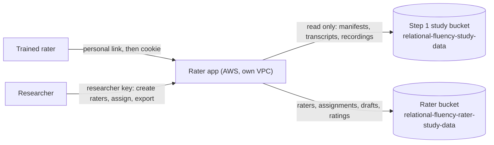

# Relational Fluency Rater

Relational Fluency Rater is step 2 of the Cornell **AI-Ready Workforce Initiative** study (PI Kizilcec, IRB0151104). Step 1, [relational-fluency](https://github.com/Cornell-AI-Ready-Workforce/relational-fluency), records each participant's four voice conversations with AI characters. This app reads those recordings, never changes them, and saves its own records to a separate bucket. Trained raters reach it through a personal link from the study team and score the conversations blind: by rating code, with no participant, scenario or character names.

**Status (2026-10-22):** the rating task is built: trained team raters sign in with a link, work through a queue of rating codes, and score each recorded conversation on the 21 ESCI items with the recording and transcript beside them ([`docs/RATING.md`](docs/RATING.md)). Ratings are written to this app's bucket. The app has not been deployed; the stack has not been applied. Planned address: <https://rater.ai-ready-workforce.ai.cornell.edu> (`/health` shows the status and build). Contact: the study team (PI Kizilcec).

## App architecture



- **Pages:** [`static/`](static/): the rater's queue (`queue.html`) and rating screen (`rate.html`), plus the sign-in and the earlier Qualtrics entry pages. These are plain HTML on step 1's theme ([`static/theme.css`](static/theme.css), taken from step 1's participant page). The Inter font is self-hosted, and the Content-Security-Policy is `default-src 'self'`, so a page contacts no other site.
- **App server:** [`server/`](server/) (FastAPI), run with `python -m server.app`.
  - [`server/conventions.py`](server/conventions.py): step 1's participant-key, cohort and session-id rules, copied from step 1 and parity-tested against it.
  - [`server/source.py`](server/source.py): reads step 1's data. It has no write path.
  - [`server/store.py`](server/store.py): writes this app's records.
  - [`server/rating.py`](server/rating.py) and [`server/items.py`](server/items.py): raters, codes, the queue, the 21 items, the submission.
- **Hosting:** AWS `us-east-1`, defined in [`infra/terraform/`](infra/terraform/). This is a separate OpenTofu stack from step 1's, kept in the same state bucket under its own key. Details are in [`docs/DEPLOY-AWS.md`](docs/DEPLOY-AWS.md).

## Where the data is

- **Step 1 recordings, read only:** `s3://relational-fluency-study-data/encounters/<session_id>/`, encrypted with KMS `alias/relational-fluency-study`. The app's role may read objects under `encounters/` and `runs/` and decrypt them through S3. Writes are explicitly denied.
- **How a participant is matched to their encounters:** the app scans the step 1 manifests. Each `manifest.json` carries `participant_key`, `run_id`, `cohort` and `encounter_index`. Step 1 keeps run documents (order, arm, Qualtrics ID, withdrawal) on its EFS volume only, so **this app cannot see withdrawals**. The proposed step 1 change that fixes this is in [`docs/step1-runs-export.md`](docs/step1-runs-export.md).
- **Transcripts:** step 1's offline re-transcription is used where it exists, and the live captions are used otherwise. Each record notes which source it used.
- **This app's records:** `s3://relational-fluency-rater-study-data/` under `raters/`, `assignments/`, `drafts/`, `ratings/` (and `entries/` from the Qualtrics path), encrypted with the app's own KMS key `alias/relational-fluency-rater-study`. Every assignment and rating names the step 1 `participant_key`, `session_ids` and `run_id` it was based on; the rater never sees that block ([`docs/RATING.md`](docs/RATING.md)).
- **Cohorts:** `study`, `internal` or `unattributed`, by exactly step 1's rule.
- **Retention:** records are kept until deleted by hand (`rater_data_retention_days = 0`). Changing that is the PI's decision.
- **Access:** the researcher key is the Secrets Manager secret `relational-fluency-rater/researcher-key`.

## Links

| Who | Link |
|---|---|
| Rater | the personal link `https://rater.ai-ready-workforce.ai.cornell.edu/rate?token=…` from `POST /api/raters`; afterwards `https://rater.ai-ready-workforce.ai.cornell.edu/rate` |
| Researcher, create a rater / assign / export | `POST /api/raters`, `POST /api/assignments`, `GET /api/ratings?format=csv`, all with `?key=RESEARCHER_KEY` ([runbook](docs/RATING.md#researcher-runbook)) |
| Participant, from Qualtrics (earlier design, still served) | `https://rater.ai-ready-workforce.ai.cornell.edu/start?pid=${e://Field/participantId}&qid=${e://Field/ResponseID}` |
| Researcher, Qualtrics entry records | `https://rater.ai-ready-workforce.ai.cornell.edu/api/entries?key=RESEARCHER_KEY` |
| Researcher, one participant's step 1 encounters | `https://rater.ai-ready-workforce.ai.cornell.edu/api/step1/participants/KEY/encounters?key=RESEARCHER_KEY` |
| Anyone, health and build | `https://rater.ai-ready-workforce.ai.cornell.edu/health` |

## Run it locally

Python 3.11–3.13 (3.12 is the reference). Each block is for one shell; they are not interchangeable.

```bash
# macOS / Linux
python3 -m venv .venv
source .venv/bin/activate
pip install -r requirements.txt
cp .env.example .env        # optional: SOURCE_DIR=../relational-fluency/data reads step 1's local sessions
python -m server.app
```

```powershell
# Windows PowerShell (if activation is refused: Set-ExecutionPolicy -Scope Process RemoteSigned)
py -3.12 -m venv .venv
.\.venv\Scripts\Activate.ps1
pip install -r requirements.txt
Copy-Item .env.example .env
python -m server.app
```

```bat
:: Windows Command Prompt
py -3.12 -m venv .venv
.venv\Scripts\activate.bat
pip install -r requirements.txt
copy .env.example .env
python -m server.app
```

Open <http://127.0.0.1:8766/health>. Then create a rater and open its link ([`docs/RATING.md`](docs/RATING.md#local-development)). The port is 8766 so the app can run beside step 1, which uses 8765.

Locally, records are written under `data/rater-records/`, never to the production bucket unless `RATER_BUCKET` is set. Step 1 data is read from `SOURCE_DIR` or `SOURCE_BUCKET`. The full walkthrough is in [`docs/TESTING-LOCALLY.md`](docs/TESTING-LOCALLY.md).

Tests: `pip install pytest httpx2 && python -m pytest tests -q -rs`. With step 1 checked out beside this repository, the parity tests also compare the copied code and assets with step 1's source.

## Docs

- [`docs/RATING.md`](docs/RATING.md): the rating task, what a rater sees, where ratings go, the researcher runbook
- [`docs/OPERATIONS.md`](docs/OPERATIONS.md): releasing a build, checking a deploy, everyday operation
- [`docs/DEPLOY-AWS.md`](docs/DEPLOY-AWS.md): the AWS stack, the first deploy, and the IAM the deploy identities need
- [`docs/TESTING-LOCALLY.md`](docs/TESTING-LOCALLY.md): running it on your own machine against step 1 data
- [`docs/step1-runs-export.md`](docs/step1-runs-export.md): the small step 1 change that would let this app see runs and withdrawals
- [`infra/README.md`](infra/README.md): what the stack creates and what it only reads
